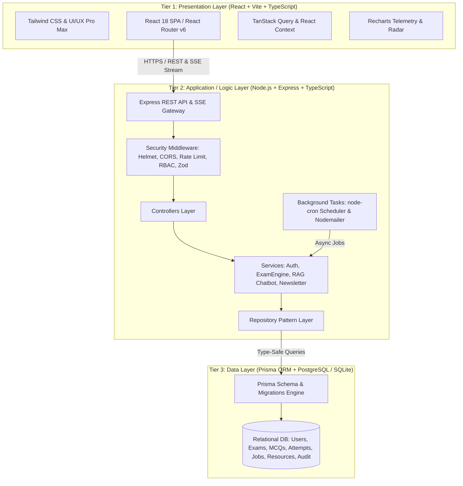
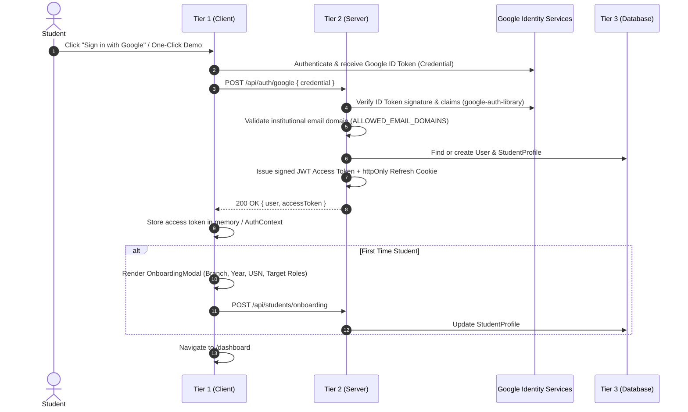
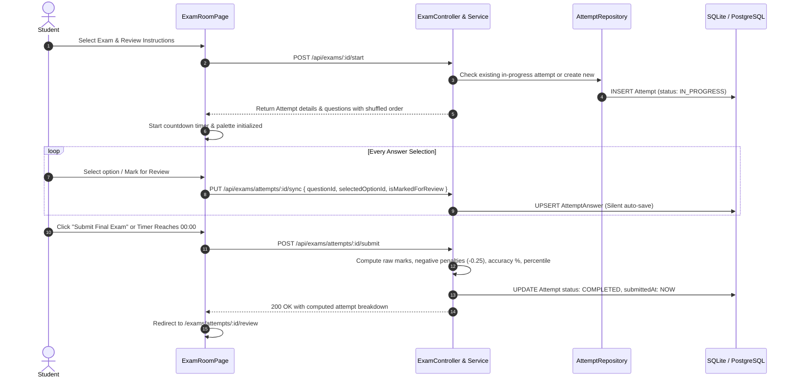
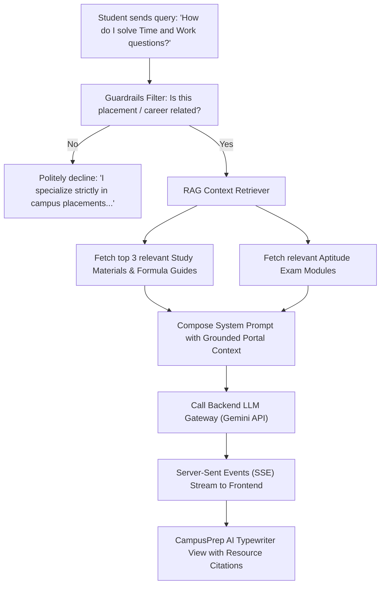

# EduConnect Architecture Specification

## 1. System Overview & Strict Three-Tier Separation

EduConnect is engineered on a strict three-tier architecture ensuring logical and physical separation between Presentation, Business Logic, and Data Persistence.

### Architectural Tenets
1. **Zero Direct DB Access from Client:** The client never has database credentials or direct connections; all queries and mutations flow through Tier 2 endpoints.
2. **Layered Decoupling:** Tier 2 follows `Routes -> Middleware -> Controllers -> Services -> Repositories`. Business rules (e.g. negative marking penalties, peer percentile computation, domain allowlist enforcement) reside exclusively in the Services layer.
3. **Protected AI Gateway:** The LLM API key (Gemini / Claude / OpenAI) is stored strictly on the server in environment variables. All prompt engineering, vector/lexical retrieval (RAG), and content moderation occur server-side before streaming text to Tier 1 via Server-Sent Events (SSE).

---

## 2. Authentication & Authorization Lifecycle

EduConnect implements passwordless **Google OAuth 2.0** verification and issues short-lived JWT access tokens paired with refresh tokens.

### Role-Based Access Control (RBAC) Matrix

| Endpoint Route Group | STUDENT | FACULTY | ADMIN | Notes |
| :--- | :---: | :---: | :---: | :--- |
| `GET /api/exams` | ✅ | ✅ | ✅ | Browse published exams |
| `POST /api/exams/:id/start` | ✅ | ✅ | ✅ | Initialize timed exam attempt |
| `PUT /api/exams/attempts/:id/sync` | ✅ | ❌ | ❌ | Auto-save answer selection |
| `POST /api/exams/attempts/:id/submit` | ✅ | ❌ | ❌ | Calculate final score & percentile |
| `GET /api/jobs` | ✅ | ✅ | ✅ | List verified campus drives |
| `POST /api/jobs/:id/report` | ✅ | ✅ | ✅ | Flag broken application links |
| `POST /api/chat/stream` | ✅ | ✅ | ✅ | SSE streaming placement assistant |
| `POST /api/admin/exams` | ❌ | ✅ | ✅ | Author new aptitude modules |
| `POST /api/admin/exams/:id/bulk-csv` | ❌ | ✅ | ✅ | Bulk import MCQs via CSV |
| `POST /api/admin/jobs` | ❌ | ✅ | ✅ | Post and verify job listings |
| `POST /api/admin/newsletters/:id/publish`| ❌ | ❌ | ✅ | Trigger broadcast & email dispatch |
| `GET /api/admin/audit-logs` | ❌ | ❌ | ✅ | Tamper-evident audit log review |
| `GET /api/admin/reports/cohort-export` | ❌ | ✅ | ✅ | Export CSV report of cohort results |

---

## 3. Exam Engine & Auto-Save Synchronization

---

## 4. Placement Chatbot RAG Orchestration

---

## 5. Background Scheduler & Email Service

1. **node-cron Jobs:**
   - **Weekly Newsletter Dispatch (`0 9 * * 1`):** Every Monday at 09:00 AM UTC, scans for scheduled newsletters and dispatches formatted HTML emails via Nodemailer to all opted-in students.
   - **Job Link Health Checker (`0 2 * * *`):** Daily at 02:00 AM UTC, performs HTTP HEAD requests on external job application links. Broken links are flagged as `isExpired = true` and alerted to administrators.
2. **Email Provider Integration:**
   - Pre-configured for standard SMTP (Nodemailer) and compatible with Resend, SendGrid, and AWS SES via environment variables.

---

## 6. Database Entity-Relationship Summary

The data tier comprises 19 relational models:
- **Identity & Profiles:** `User`, `StudentProfile`
- **Aptitude System:** `Exam`, `Question`, `QuestionOption`, `Attempt`, `AttemptAnswer`
- **Career & Jobs:** `JobListing`, `JobBookmark`, `JobReport`
- **Learning Content:** `StudyMaterial`, `MaterialBookmark`, `MaterialProgress`
- **Communications:** `Newsletter`, `NewsletterSubscription`, `Notification`
- **AI Mentorship:** `ChatSession`, `ChatMessage`
- **Governance:** `AuditLog`
