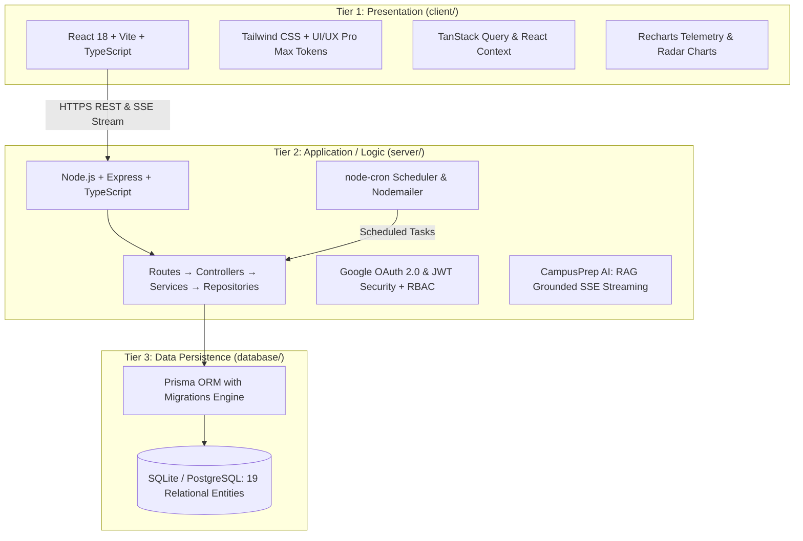

# EduConnect | Campus Placement Preparation Portal

EduConnect is an enterprise-grade, full-stack EdTech and campus-placement preparation platform engineered with a strict **three-tier architecture**. It empowers students with structured placement readiness through 20 full-length MCQ aptitude exams, verified job opportunities with provenance tracking, weekly strategy newsletters, curated study resources, and an AI mentor (**CampusPrep AI**) grounded with Retrieval-Augmented Generation (RAG).

---

## 🏛️ Strict Three-Tier Architecture

EduConnect enforces logical and physical decoupling across presentation, business logic, and persistence:



For complete technical specifications, review [`ARCHITECTURE.md`](./ARCHITECTURE.md).  
For UI/UX design tokens and WCAG AA guidelines, review [`DESIGN_SYSTEM.md`](./DESIGN_SYSTEM.md).

---

## 🚀 Key Features

### 1. 20 Full-Length MCQ Aptitude Exams
- **Curated Coverage:** 20 full exams spanning Quantitative Aptitude, Logical Reasoning, Verbal Ability, Data Interpretation, Computer Science Fundamentals, and Core Engineering.
- **Exam Engine:** Pre-test instructions screen, live countdown timer with auto-submit, question palette (Answered, Unanswered, Marked for Review), and instant answer synchronization.
- **Scoring & Penalties:** Configurable negative marking (`-0.25`), instant score calculation, accuracy percentages, peer percentile benchmarking, and detailed step-by-step analytical derivations for every question.

### 2. Verified Campus Placement Drives & Jobs
- **Authenticity Assurance:** Every listing features an interactive **"Verified" badge** detailing verification provenance (verifier identity, timestamp, and institutional source).
- **Broken Link Protection:** Student "Report Broken Link" modal and automated daily health check crons.
- **Tracking:** Application link click-through telemetry and bookmarking.

### 3. Weekly Placement Newsletter
- **Editorial Studio:** Admin rich-text drafting, previewing, and scheduling.
- **Automated Dispatch:** Built with `node-cron` and Nodemailer/SMTP for automated weekly distribution to subscribed students.
- **Student Archive:** Full web archive of past editions with one-click subscribe/unsubscribe toggle.

### 4. Categorized Study Materials Hub
- **3 Core Categories:** Aptitude Formulas, Technical Computer Science, and Comprehensive Interview Prep (HR behavioral, GD frameworks, Resume templates).
- **Formats:** PDF guides, formula cheat-sheets, video playlists, and practice problem sets with "Mark as Completed" tracking.

### 5. CampusPrep AI Mentorship (RAG Chatbot)
- **Zero Exposure:** LLM API keys stay strictly on the backend.
- **Grounded Responses:** RAG pipeline searches portal materials, syllabus topics, and past newsletter tips to provide contextual answers with direct citations.
- **Exam Assistant:** "Explain this Question" button on exam review screens providing AI derivations.
- **Strict Guardrails:** Restricts conversations to career guidance, interview prep, and technical doubts.

### 6. Faculty & Placement Cell Administration Suite
- **Cohort Analytics:** Real-time metrics on student participation, category accuracy distribution, and job click-through rates.
- **Student Directory:** Search by USN/roll number, inspect individual performance, toggle active/suspended status, and **"Export Cohort CSV"**.
- **Bulk MCQ Upload:** Fast CSV importer for authoring exams in bulk.
- **Audit Trail:** Immutable event log tracking all administrative interventions.

---

## 🔑 Test Credentials & One-Click Demo

EduConnect includes pre-configured demo authentication buttons on the login page for zero-friction evaluation:

| Role | Email | Password / Auth Mode | Pre-seeded Features |
| :--- | :--- | :--- | :--- |
| **Student** | `student@educonnect.ac.in` | **One-Click Demo** / Google Auth | Profile initialized, 1 completed exam attempt, saved jobs |
| **Admin / Faculty** | `admin@educonnect.ac.in` | **One-Click Demo** / Google Auth | Full access to Cohort Analytics, MCQ Importer, Jobs Verifier |

---

## 💻 Local Development Setup

### Prerequisites
- Node.js v20.x or higher
- npm v10.x or higher

### Step 1: Clone & Configure Environment
```bash
# Clone the repository
git clone https://github.com/your-org/EduConnect.git
cd EduConnect

# Copy environment variables template
cp .env.example .env
```

### Step 2: Install Dependencies & Build Packages
```bash
# Install server dependencies
cd server
npm install
npm run build

# Install client dependencies
cd ../client
npm install
npm run build
```

### Step 3: Initialize Database & Run Seed Data
```bash
cd ../database
npx prisma db push --schema=./schema.prisma

# Execute rich seed script (20 exams, 304 MCQs, verified jobs, newsletters, resources)
npm run seed --prefix ../server
```

### Step 4: Launch Development Servers
In two separate terminals:

```bash
# Terminal 1: Launch Backend API (Port 5000)
cd server
npm run dev

# Terminal 2: Launch Frontend Client (Port 5173)
cd client
npm run dev
```

Visit **`http://localhost:5173`** in your browser.

---

## 🐳 Docker Deployment

To launch the complete three-tier stack (PostgreSQL + Express API + React Nginx) using Docker Compose:

```bash
docker-compose up --build
```
- Presentation (Client): `http://localhost`
- Application (Server API): `http://localhost:5000/api/health`
- Database: PostgreSQL on port `5432`

---

## 📁 Repository Layout

```
EduConnect/
├── client/                     # Tier 1: Presentation Layer
│   ├── src/
│   │   ├── components/
│   │   │   ├── auth/          # Google Sign-in & OnboardingModal
│   │   │   ├── chat/          # FloatingChatWidget with SSE stream
│   │   │   ├── layout/        # Navbar, Sidebar, DistractionFreeExamLayout
│   │   │   └── ui/            # Button, Badge, Card, Modal, Input, Tabs
│   │   ├── context/           # AuthContext & ThemeContext (Light/Dark)
│   │   ├── pages/             # 11 Student & 6 Faculty Admin Views
│   │   ├── services/          # Strongly-typed Axios/Fetch API client
│   │   └── types/             # Shared TypeScript models
│   ├── Dockerfile
│   └── vite.config.ts
├── server/                     # Tier 2: Application / Business Logic Layer
│   ├── src/
│   │   ├── config/            # Prisma, ENV, and JWT configs
│   │   ├── controllers/       # HTTP request handlers
│   │   ├── cron/              # node-cron weekly newsletter & link checker
│   │   ├── middleware/        # RBAC, JWT auth, Zod validation, ErrorHandler
│   │   ├── repositories/      # Prisma DB query layer
│   │   ├── routes/            # REST API route declarations
│   │   ├── services/          # Core business logic & Gemini RAG
│   │   └── test/              # 15/15 Integration test suite
│   └── Dockerfile
├── database/                   # Tier 3: Data Persistence Layer
│   ├── schema.prisma          # 19 Relational database entities
│   ├── seed-data/             # 20 MCQ exams, jobs, newsletters, materials
│   └── dev.db                 # Zero-config SQLite database
├── ARCHITECTURE.md             # Detailed three-tier specification & diagrams
├── DESIGN_SYSTEM.md            # Color tokens, typography, and UX guidelines
├── docker-compose.yml          # Multi-container production deployment
└── README.md                   # Project overview & running instructions
```

---

## 🧪 Automated Testing

Run the full integration test suite covering authentication, 20 seeded exams, question bank, and negative marking formulas:

```bash
cd server
npm test
```
Result: **15 / 15 Passed** (100% test pass rate).
